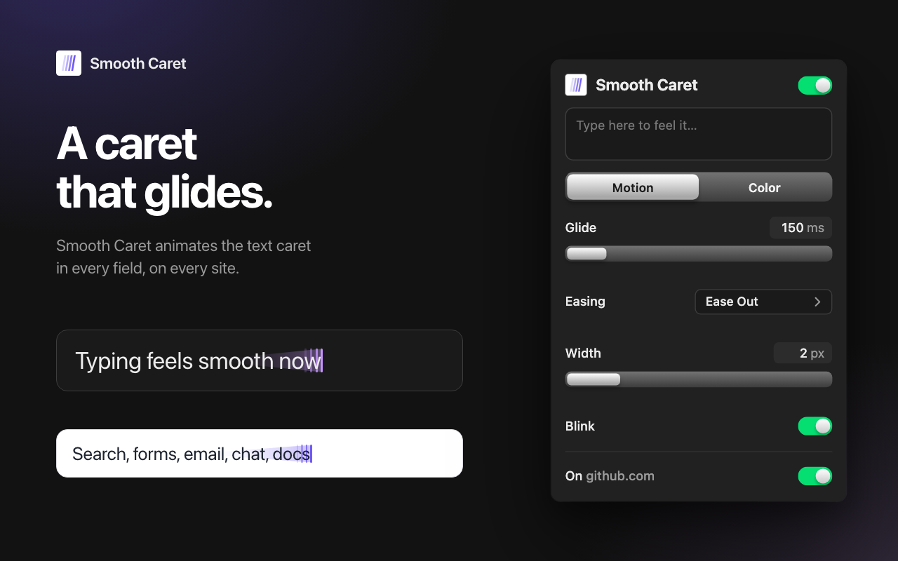

# Smooth Caret

A smooth, gliding text caret on every site. When you type, click or use the arrow keys, the caret slides to its new spot instead of jumping there: in inputs, textareas, rich editors and Google Docs. It's a Chrome extension, plus one script for desktop apps built on Electron.



## Install in Chrome

**[Install from the Chrome Web Store](https://chromewebstore.google.com/detail/smooth-caret/hdghohaibiopphhalknjindnpghhhkkh)**

**Developer install:** download this repo (**Code → Download ZIP**, then unzip it). Open `chrome://extensions`, turn on **Developer mode**, click **Load unpacked** and pick the `extension` folder. There's nothing to build.

Pin it from the puzzle-piece menu. The popup has a field to try it in, and every change applies live in every tab:

- Glide time, and the easing: Ease Out, Ease In & Out, Spring or Linear
- Caret width
- Any color with opacity, an eyedropper, or **Match text** to keep each site's own caret color
- **Rainbow**, which cycles through the hues at the speed you pick
- Blink on or off, and a switch to turn it off on the current site

## Install in an Electron app

Desktop apps like Claude, Slack, Discord and Notion are web pages inside Electron, where Chrome extensions can't reach. [`smooth-caret.js`](smooth-caret.js) is the same caret and settings menu as a single script you paste into the app's DevTools. Tap **Right Shift** to show or hide its menu. Settings are saved in the app.

### Paste it into DevTools

1. **Turn on DevTools**, if the app keeps them off:
   - **Claude:** run this, then quit and reopen Claude:
     ```bash
     echo '{"allowDevTools": true}' > ~/Library/Application\ Support/Claude/developer_settings.json
     ```
   - **Discord:** quit Discord, add `"DANGEROUS_ENABLE_DEVTOOLS_ONLY_ENABLE_IF_YOU_KNOW_WHAT_YOURE_DOING": true` to `~/Library/Application Support/discord/settings.json`, and reopen it.
   - **Other apps** often have DevTools on already. If the shortcut in step 3 does nothing, the prompt below can find the setting for you.
2. **Copy the script.** On a Mac this puts it on your clipboard:
   ```bash
   curl -s https://raw.githubusercontent.com/dooovid/smooth-caret/main/smooth-caret.js | pbcopy
   ```
   Or open [`smooth-caret.js`](smooth-caret.js) on GitHub and use its **Copy raw file** button.
3. **Paste it into the console.** Press ⌘⌥I (Ctrl+Shift+I on Windows and Linux), open the **Console** tab, paste and press Enter. If the console warns you about pasting, type `allow pasting`, press Enter and paste again.

It lasts until the window reloads or the app restarts, so paste it again then. To make that quicker, save it once as a snippet under **Sources → Snippets** and run it from there with ⌘Enter (Ctrl+Enter).

**Prompt for an agent:** a coding agent (Claude Code, Codex, Cursor…) can do steps 1 and 2 for you. Paste this in, with your app's name in the first line:

```text
Help me run Smooth Caret in my ___ desktop app by pasting it into the app's DevTools console.

Smooth Caret (https://github.com/dooovid/smooth-caret) gives text fields a smooth, gliding caret. For apps a browser extension can't reach, it ships as one self-contained script:
https://raw.githubusercontent.com/dooovid/smooth-caret/main/smooth-caret.js
Pasting it into a page's console starts the caret right away and adds a small settings menu (Right Shift shows or hides it). Running it a second time only reopens the menu.

1. Check that the app is built on Electron (or Chromium).
2. Find out whether its DevTools are turned off, and if so, how this app turns them on (a settings file, a flag, an environment variable). Turn them on without modifying the app's own files: they're code-signed and get replaced on every update. Back up any file you change, and ask me before quitting the app if it needs a restart.
3. Download the script and read it before I run it. It should make no network requests. Then copy it to my clipboard.
4. Tell me the shortcut that opens DevTools in this app.

When you're done, tell me how to undo the DevTools change.
```

### More permanent: a launcher made by an agent

Pasting has to be redone every time the app starts. If you want Smooth Caret in every window automatically, a coding agent can build you a launcher that starts the app and injects the script itself. It works over the app's remote debugging port, so while the app runs this way, other programs on your computer can control it too. Paste this in, with your app's name in the first line:

```text
Set up Smooth Caret in my ___ desktop app with a launcher.

Smooth Caret (https://github.com/dooovid/smooth-caret) gives text fields a smooth, gliding caret. For apps a browser extension can't reach, it ships as one self-contained script:
https://raw.githubusercontent.com/dooovid/smooth-caret/main/smooth-caret.js
Running it in a page starts the caret right away and adds a small settings menu (Right Shift shows or hides it). Settings are saved in the page's localStorage. Running it a second time only reopens the menu, so injecting it twice is harmless.

What I want: Smooth Caret in every window of the app, every time I open it, and after the app reloads a window. Don't modify the app's own files: they're code-signed and get replaced on every update.

1. Check that the app is built on Electron (or Chromium), and find how to start it from the command line on this computer.
2. Download the script and read it before running it. It should make no network requests.
3. Build a small launcher that quits the app if it's running, starts it with --remote-debugging-port on 127.0.0.1, and stays connected over the Chrome DevTools Protocol. For every page target, including windows opened later, it calls Page.addScriptToEvaluateOnNewDocument with the script, plus Runtime.evaluate once for the page that's already loaded. Make the launcher one thing I can double-click or run, and have it exit when the app quits.
4. If the app ignores or blocks the debugging flag, stop and tell me. I'll paste the script into DevTools instead.
5. Tell me the trade-off: while the debugging port is open, other programs on this computer can control the app.

When you're done, tell me how to start the app with Smooth Caret, and how to undo everything.
```

## Privacy

Smooth Caret runs entirely on your device. It sends nothing anywhere and stores only its own settings. See [PRIVACY.md](PRIVACY.md).

## Development

How it finds the caret, the tests, rebuilding `smooth-caret.js` and publishing to the Chrome Web Store are covered in [dev/README.md](dev/README.md).

## License

[GPL-3.0](LICENSE). The popup's design and the logo come from the SmoothCursorExtension and Silk Type projects.
