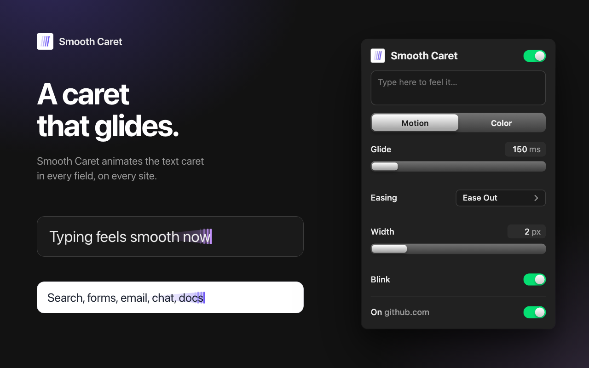

# Smooth Caret

A smooth, gliding text caret on every site. When you type, click or use the arrow keys, the caret slides to its new spot instead of jumping there: in inputs, textareas, rich editors and Google Docs. It's a Chrome extension, plus one script for desktop apps built on Electron.



## Install in Chrome

**Chrome Web Store:** coming soon.

**Developer install:** download this repo (**Code → Download ZIP**, then unzip it). Open `chrome://extensions`, turn on **Developer mode**, click **Load unpacked** and pick the `extension` folder. There's nothing to build.

Pin it from the puzzle-piece menu. The popup has a field to try it in, and every change applies live in every tab:

- Glide time, and the easing: Ease Out, Ease In & Out, Spring or Linear
- Caret width
- Any color with opacity, an eyedropper, or **Match text** to keep each site's own caret color
- **Rainbow**, which cycles through the hues at the speed you pick
- Blink on or off, and a switch to turn it off on the current site

## Install in an Electron app

Desktop apps like Claude, Slack, Discord and Notion are web pages inside Electron, where Chrome extensions can't reach. [`smooth-caret.js`](smooth-caret.js) is the same caret and settings menu as a single script that runs inside the app. Tap **Right Shift** to show or hide its menu. Settings are saved in the app.

The easy way is to have a coding agent (Claude Code, Codex, Cursor…) set it up. Paste this in, with your app's name in the first line:

```text
Set up Smooth Caret in my ___ desktop app.

Smooth Caret (https://github.com/dooovid/smooth-caret) gives text fields a smooth, gliding caret. For apps a browser extension can't reach, it ships as one self-contained script:
https://raw.githubusercontent.com/dooovid/smooth-caret/main/smooth-caret.js
Running it in a page starts the caret right away and adds a small settings menu (Right Shift shows or hides it). Settings are saved in the page's localStorage. Running it a second time only reopens the menu, so injecting it twice is harmless.

What I want: Smooth Caret in every window of the app, every time I open it, and after the app reloads a window. Don't modify the app's own files: they're code-signed and get replaced on every update.

1. Check that the app is built on Electron (or Chromium), and find how to start it from the command line on this computer.
2. Download the script and read it before running it. It should make no network requests.
3. Preferred method: a small launcher that quits the app if it's running, starts it with --remote-debugging-port on 127.0.0.1, and stays connected over the Chrome DevTools Protocol. For every page target, including windows opened later, it calls Page.addScriptToEvaluateOnNewDocument with the script, plus Runtime.evaluate once for the page that's already loaded. Make the launcher one thing I can double-click or run, and have it exit when the app quits.
4. If the app ignores or blocks the debugging flag, fall back to the app's DevTools instead: save the script as a Sources > Snippets snippet, and tell me how to run it after each launch (and how to turn DevTools on for this app, if it needs a setting).
5. Tell me the trade-off: while the debugging port is open, other programs on this computer can control the app.

When you're done, tell me how to start the app with Smooth Caret, and how to undo everything.
```

**By hand:** open the app's DevTools if it has them (often ⌘⌥I or Ctrl+Shift+I). Go to **Sources → Snippets → New snippet**, paste in all of `smooth-caret.js`, save, and run it with ⌘Enter or Ctrl+Enter. It has to be run again each time the app starts. The Claude desktop app keeps DevTools off until you run `echo '{"allowDevTools": true}' > ~/Library/Application\ Support/Claude/developer_settings.json` and restart it.

## Privacy

Smooth Caret runs entirely on your device. It sends nothing anywhere and stores only its own settings. See [PRIVACY.md](PRIVACY.md).

## Development

How it finds the caret, the tests, rebuilding `smooth-caret.js` and publishing to the Chrome Web Store are covered in [dev/README.md](dev/README.md).

## License

[GPL-3.0](LICENSE). The popup's design and the logo come from the SmoothCursorExtension and Silk Type projects.
